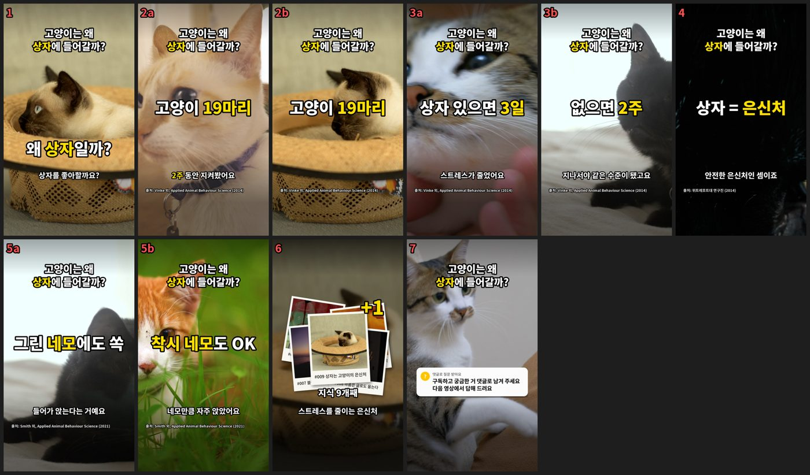
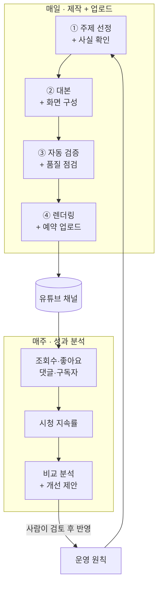
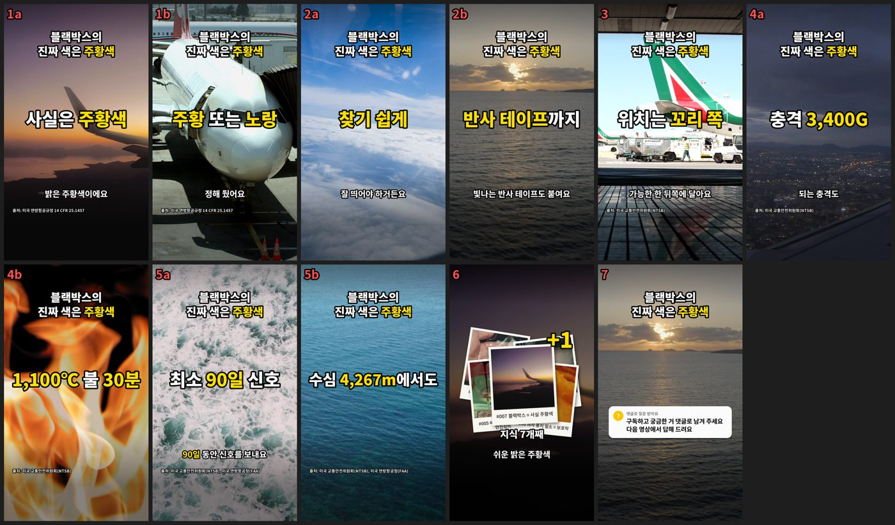

# 지식 한 장 — AI 에이전트가 매일 운영하는 유튜브 쇼츠 채널

> **유튜브 채널 ▶ [@jisik_hanjang](https://www.youtube.com/@jisik_hanjang)**
>
> 생활 속 "이거 왜 그러지?"를 공식·학술 출처로 확인해서 1분 안팎의 쇼츠로 설명하는 한국어 지식 채널입니다.
> 주제 선정부터 사실 확인, 대본, 영상 제작, 유튜브 업로드, 성과 분석까지 **AI 에이전트가 매일 자동으로** 진행하고,
> 저는 채널 방향과 운영 원칙을 정하고 결과를 검수하는 역할을 맡았습니다.

| 항목 | 내용 |
|---|---|
| 기간 | 2026.10.26 ~ 운영 중 |
| 역할 | 기획, 자동화 시스템 설계·구현, 운영 원칙 결정, 검수 (1인) |
| 결과 (2026.11.02 기준) | 영상 **19편** 제작, 하루 2편 무인 공개, 구독자 13명, 누적 조회 약 1만 회 |
| 운영 비용 | **추가 비용 0원** (AI 구독 외 유료 서비스 없음) |
| 기술 키워드 | AI 에이전트(Claude Code), Python, 자체 영상 렌더링 엔진, YouTube API |

---

## 1. 어떤 채널인가요

   
  #009 「고양이는 왜 상자만 보면 들어갈까?」 장면 미리보기

- **주제**: 매운맛은 맛이 아니다, 엘리베이터에 거울이 있는 진짜 이유, 블랙박스는 사실 주황색 같은 "알고 나면 남한테 말하고 싶은" 생활 지식
- **형식**: 실제 촬영 영상 + 큰 자막 + AI 내레이션, 1분 안팎
- **채널의 표시**: 영상 끝마다 "지식 한 장 추가!" 폴라로이드가 한 장씩 쌓여, 채널을 볼수록 지식 도감이 채워지는 연출
- **시청자 참여**: 마지막에 질문을 받고, 실제 댓글 질문을 다음 영상 주제로 씁니다
- **투명성**: 모든 사실의 출처를 설명란에 적고, 유튜브의 "AI 사용(변경·합성 콘텐츠)" 표시를 켭니다

**영상 예시**

| 편 | 제목 | 링크 |
|---|---|---|
| #004 | 엘리베이터에 거울이 있는 진짜 이유 (얼굴 보라고 아님) | [보기](https://youtube.com/shorts/qtyrw1JyRSM) |
| #005 | 담배 금지인 비행기 화장실에 재떨이가 있는 이유 | [보기](https://youtube.com/shorts/wtMg70ggyUc) |
| #006 | 과자 봉지는 왜 빵빵할까? 그 공기의 정체 | [보기](https://youtube.com/shorts/WXuFTv88JkM) |
| #007 | 블랙박스는 사실 까맣지 않다? 진짜 색은 주황색 | [보기](https://youtube.com/shorts/OnRvD19GQNk) |
| #008 | 하품은 왜 옮을까? 글만 읽어도 옮는 이유 | [보기](https://youtube.com/shorts/0k1E8YF_l0A) |
| #009 | 고양이는 왜 상자만 보면 들어갈까? | [보기](https://youtube.com/shorts/LEnWRVrV9HM) |
| #010 | 양파 썰면 왜 눈물이 날까? 범인은 숨은 효소 | [보기](https://youtube.com/shorts/pYitV8iWC0w) |
| #011 | 손가락 꺾을 때 '뚝' 소리, 뼈 소리가 아니다? | [보기](https://youtube.com/shorts/AH-UuN0_Rt8) |

---

## 2. 어떻게 돌아가나요

사람이 매일 하는 일은 없습니다. 제작과 분석이 정해진 시간에 자동으로 실행되고, 사람은 결과를 보고 방향만 정합니다.

- **주제 선정**: 시청자 댓글 질문을 우선하고, 주제가 떨어지면 채널 기준에 맞는 새 주제를 스스로 보충합니다. 돈·법률·의료처럼 민감한 주제는 다루지 않습니다.
- **사실 확인**: 정부·대학·학술지 같은 공식 출처로만 확인하고, 규정·기준처럼 바뀔 수 있는 숫자는 최신인지 한 번 더 확인합니다.
- **대본·화면**: 첫 몇 초 안에 궁금증을 만들고, 말하는 내용에 맞는 실제 영상을 장면마다 고릅니다.
- **검증·점검**: 숫자가 출처와 맞는지, 최근 영상과 겹치지 않는지 등을 자동으로 검사하고, 렌더링 전 화면을 에이전트가 직접 보고 고칩니다.
- **업로드**: '비공개 + 예약 공개'로 올려서, 공개 전까지 사람이 언제든 막을 수 있게 했습니다.

   
  #007 「블랙박스의 진짜 색은 주황색」 — 말하는 내용에 맞춰 장면이 바뀝니다

---

## 3. 제가 설계한 것

### ① 틀리지 않는 지식 채널
- 영상 속 숫자는 출처와 대조되지 않으면 통과하지 못하게 만들었습니다.
- **사례**: 운영 초기 원고 검수 중 항공 장비 기준이 개정 전 숫자로 들어간 것을 찾아 바로잡고, "바뀔 수 있는 숫자는 최신 기준 재확인" 원칙을 시스템에 넣었습니다.

### ② 찍어 낸 영상처럼 보이지 않게
- 유튜브는 대량 생산·반복 콘텐츠의 수익 창출을 제한합니다. 그래서 시작 방식, 제목 모양, 장면 흐름, 마무리 말이 최근 영상과 겹치지 않도록 자동으로 막습니다.
- 처음 하루 3편 계획을 **2편으로 줄인 것**도 품질·사실 확인 여유·정책 위험을 함께 고려한 결정입니다.

### ③ 저작권·라이선스 사고를 시스템으로 차단
- 운영 중 일부 영상 소재가 겉보기와 달리 "유튜브 사용 불가" 조건이라는 것을 직접 발견했습니다.
- **전수 조사 후 공개 전 영상 9편을 모두 다시 제작**했고, 같은 문제가 다시 생기지 않도록 소재 선택부터 업로드까지 여러 단계에서 자동으로 막는 장치를 만들었습니다. 덕분에 화질도 함께 좋아졌습니다.

### ④ 자체 영상 렌더링 엔진
- 내레이션의 단어 타이밍에 맞춰 장면 전환·큰 글자·숫자 연출이 나오도록 직접 만든 Python 렌더링 엔진입니다 (전체 시스템 약 4,700줄).
- 세로 화면 구도 잡기, 댓글 말풍선, 폴라로이드 수집 연출, 썸네일까지 자동으로 처리합니다.
- **사례**: "마지막 멘트가 어색하다"는 피드백을 감으로 고치지 않고, 음성의 쉬는 간격을 측정해 원인을 찾아 해결했습니다.

### ⑤ 업로드·운영 자동화
- 유튜브 API로 예약 업로드, AI 사용 표시, 중복 업로드 방지, 일정 관리까지 자동화했습니다.
- 로그인 만료나 업로드 제한 같은 운영 문제를 미리 감지해, 매일 보고에서 알려 주도록 했습니다.

### ⑥ 숫자로 개선하기
- 매일 영상별 성과를 기록하고, 공개 후 같은 시간 기준으로 맞춰 공정하게 비교합니다.
- 매주 자동 보고서가 잘된 영상과 안 된 영상의 차이를 분석하고 다음 주 개선안을 제안합니다.
- **발견**: 지금까지 모든 영상이 첫 24시간 약 1,200회에서 멈춥니다 (유튜브의 초기 시험 노출로 추정). 이 벽을 넘기 위한 대본 원칙을 도입하고 효과를 측정하고 있습니다.

### ⑦ 사람과 AI의 역할 나누기
- **사람(저)**: 방향과 원칙 결정 — 하루 편수, 문구·표현 원칙, 라이선스 정책, 공개 여부
- **AI 에이전트**: 정해진 원칙 안에서 매일 실행하고 보고
- 자동 실행 중 외부로 나가는 행동은 **예약 업로드 하나만** 허용했습니다. 바로 공개, 수정, 삭제, 결제는 하지 않도록 막았습니다.

---

## 4. 문제 해결 경험

| 문제 | 해결 | 결과 |
|---|---|---|
| 원고에 개정 전 기준 숫자가 들어감 | 최신 기준 재확인 원칙을 자동화에 추가 | 사실 오류 사전 차단 |
| 영상 소재의 사용 조건이 겉보기와 다름 | 전수 조사, 9편 재제작, 다단계 자동 차단 | 라이선스 위험 제거 + 화질 개선 |
| 쇼츠 화질이 흐림 | 원인 분석 후 소재 기준 상향 | 고해상도 영상으로 전환 |
| 마지막 멘트가 부자연스러움 | 음성 간격을 측정해 원인 수정 | 자연스러운 멘트로 개선 |
| 업로드가 중간에 막힘 | 플랫폼 제한을 분석해 일정 재조정 | 공개 일정 유지 |

---

## 5. 결과와 다음 목표

- 약 1주일 만에 기획 → 자동화 → 운영까지 완료, **19편 제작 · 하루 2편 무인 공개**
- 운영비 0원 (AI 구독 외 추가 비용 없음)
- 편당 첫 24시간 약 1,200회, 구독자 13명 (2026.11.02)
- **다음 목표**: 첫 24시간 1,200회 벽 넘기 — 시청 지속률을 높이는 대본·화면 실험을 주간 분석으로 측정하며 개선

---

이 저장소는 프로젝트 소개 문서입니다. 채널: [youtube.com/@jisik_hanjang](https://www.youtube.com/@jisik_hanjang)
